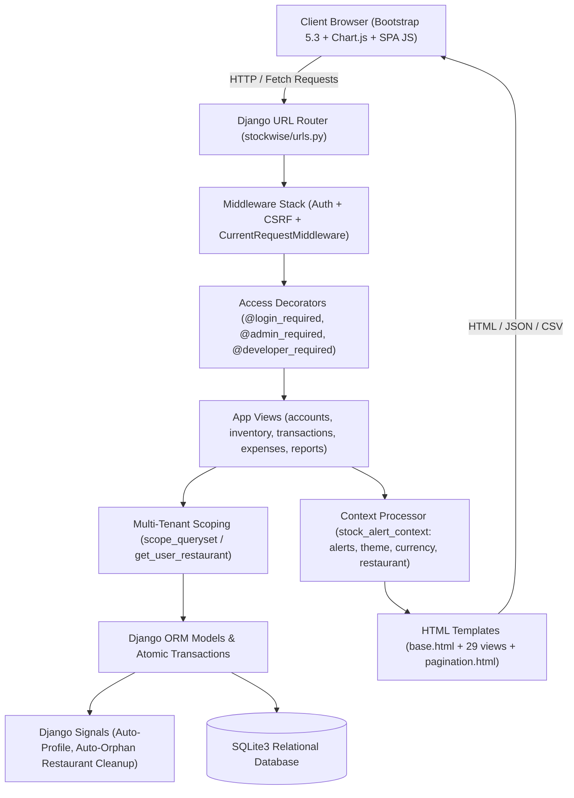
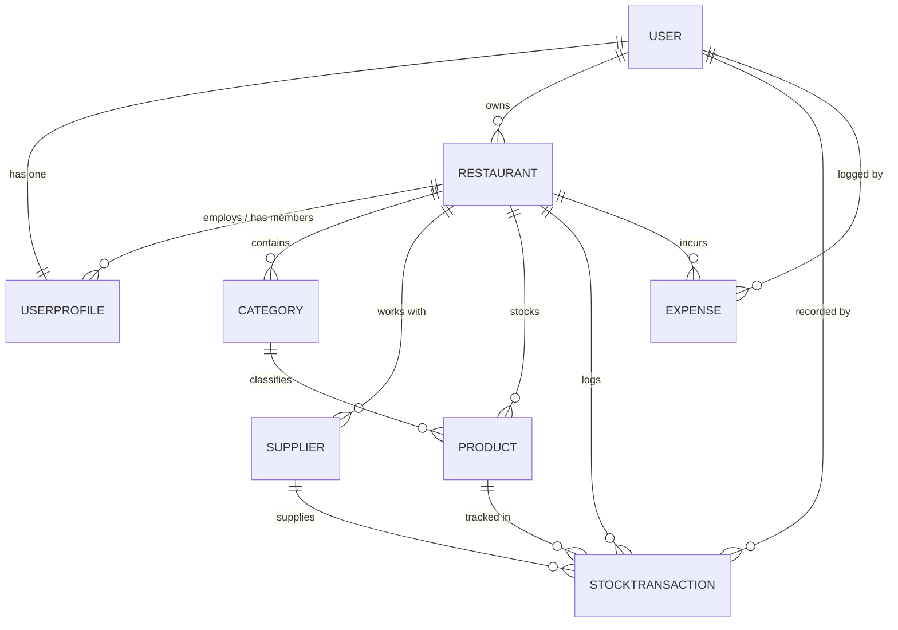

# Invenpro — Multi-Tenant Restaurant Inventory & Operations Management System
**Comprehensive Technical & Functional Project Reference (for Project Report Preparation)**

---

## 1. Project Overview & Executive Summary

- **Project Title:** Invenpro — Enterprise Multi-Tenant Inventory Management System
- **Domain:** Restaurant & Hospitality Supply-Chain, Kitchen Inventory, and Financial Operations
- **Developer Contact:** `mamuedits@gmail.com`
- **Architecture Style:** Multi-Tenant SaaS Web Application (Django MVT + Seamless Client-Side SPA Navigation)
- **Target Users:** System Developers (Platform Governance), Restaurant Owners / Admins, and Kitchen / Store Staff

### 1.1 Problem Statement
Restaurants and food-service businesses manage dozens of fast-moving consumables—grains, spices, oils, beverages, and packaging materials—every day. Manual registers or disconnected spreadsheets commonly result in:
1. **Unnoticed Stockouts:** Running out of essential ingredients mid-service because reorder checks are reactive rather than consumption-based.
2. **Negative or Inconsistent Inventory:** Concurrent manual edits and lack of validation causing inaccurate stock counts and audit discrepancies.
3. **Lack of Financial Visibility:** Difficulty tracking combined monthly cash outflow (raw material purchases + operational overheads such as rent, utilities, and wages).
4. **No Multi-Tenant Isolation:** Single-store tools cannot cleanly manage multiple independent restaurants under one platform without mixing inventory, staff, or ledger data.

### 1.2 Proposed Solution
**Invenpro** solves these challenges with a centralized, multi-tenant web platform built on **Python & Django**:
- **Strict Multi-Tenancy:** Every registered restaurant receives a unique system-allotted Restaurant ID (`RES-XXXXX`) and operates in an isolated workspace for its products, categories, suppliers, stock transactions, expenses, and staff.
- **Atomic Inventory Ledger:** Stock-In (purchases), Stock-Out (consumption), and Audit Adjustments execute inside database transactions with row-level locking (`select_for_update()`), strictly preventing negative stock.
- **Smart Stock Alert & Predictive Runway Engine:** Goes beyond static thresholds by computing trailing 7-day and 30-day daily burn rates, projecting remaining days of stock runway, sorting depleted/low items to the top, flashing real-time alerts on stock-out, and displaying a live red notification bubble on the header bell icon.
- **End-to-End Financial & Visual Analytics:** Combines purchase valuation, consumption cost, and operating expenses into interactive Chart.js dashboards and downloadable CSV reports with real-time multi-currency conversion (`INR`, `USD`, `EUR`, `GBP`, `AED`).
- **Modern Enterprise UX:** Dual Light Mode & Forest Dark Mode themes, collapsible persistent sidebar with seamless fetch-based SPA navigation (no sidebar flicker/reload), and permanent elided pagination with page-jump support.

### 1.3 Live Project Snapshot (Current Codebase Metrics)
| Metric | Value |
| :--- | :--- |
| **Python Runtime** | Python `3.14.7` |
| **Web Framework** | Django `6.1.2` |
| **Custom Django Apps** | 5 (`accounts`, `inventory`, `transactions`, `expenses`, `reports`) |
| **Database Models** | 6 Core Models (`Restaurant`, `UserProfile`, `Category`, `Supplier`, `Product`, `StockTransaction`, `Expense` + Django `User`) |
| **HTML Templates** | 30 Modular Templates |
| **Automated Test Suite** | 19 Passing Unit & Integration Tests (`Ran 19 tests ... OK`) |
| **Seeded Sample Data** | 2 Restaurants, 20 Categories, 18 Suppliers, 98 Products (49/restaurant), 1,514 Stock Transactions, 14 Expenses |

---

## 2. Technology Stack & Tools

| Layer | Technology / Library | Purpose |
| :--- | :--- | :--- |
| **Backend Language** | Python 3.14 | Core business logic, signals, calculations, and views |
| **Backend Framework** | Django 6.1 (MVT) | Routing, ORM, Authentication, CSRF/XSS protection, Migrations, Template Engine |
| **Database** | SQLite3 (`db.sqlite3`) | Relational storage with ACID transactions and foreign-key cascades (PostgreSQL-ready) |
| **Frontend Markup** | HTML5 + Django Templates | Semantic views, template inheritance (`base.html`), reusable partials |
| **Styling & Design System** | Bootstrap 5.3.3 + Custom CSS (`stockwise.css`) | Responsive grid, modals, CSS custom properties for Light & Forest Dark themes |
| **Icons & Typography** | Bootstrap Icons 1.11.3 + Google Fonts (`Inter`) | Crisp iconography and enterprise SaaS typography |
| **Client-Side Interactivity** | Vanilla JavaScript (`stockwise.js`) | Seamless PJAX/SPA navigation, live Stock-In/Out calculators, password eye toggles, sidebar persistence |
| **Data Visualization** | Chart.js 4.4.2 | 7-day Stock-In vs Stock-Out bar charts, Category valuation doughnuts, Top Consumed & Expense breakdown charts |
| **Reporting / Export** | Python `csv` module | Streaming CSV exports for Purchases, Usage, Expenses, and Inventory Valuation |
| **Testing** | Django `TestCase` & `Client` | Automated model, signal, RBAC, multi-tenancy, and view testing |

---

## 3. System Architecture & Project Structure

### 3.1 Architectural Overview (MVT + Multi-Tenant Isolation Layer)


### 3.2 Directory & Module Structure
```text
Pythonproject/
├── manage.py                         # Django CLI entrypoint
├── db.sqlite3                        # Relational SQLite database
├── db_tool.py                        # Database inspection & utility helper
├── stockwise/                        # Core Django project configuration
│   ├── settings.py                   # Apps, middleware, context processors, template builtins
│   ├── urls.py                       # Root URL router
│   ├── wsgi.py / asgi.py             # Deployment entrypoints
├── accounts/                         # Multi-tenancy, Auth, RBAC, Admin & Staff Management
│   ├── models.py                     # Restaurant, UserProfile, auto-deletion signals
│   ├── views.py                      # Login, Register, Staff Mgmt, Developer Admin Mgmt, Edit Admin, Theme Toggle
│   ├── forms.py                      # Registration, Login, Staff Creation, Settings, Profile Forms
│   ├── decorators.py                 # @admin_required, @developer_required
│   ├── middleware.py                 # CurrentRequestMiddleware
│   ├── utils.py                      # Tenant scoping helpers & restaurant starter-pack seeder
│   ├── urls.py                       # Accounts route definitions
│   └── tests.py                      # Multi-tenant deletion & admin editing unit tests
├── inventory/                        # Dashboard, Products, Categories, Suppliers, Smart Alerts
│   ├── models.py                     # Category, Supplier, Product (burn-rate & runway analysis)
│   ├── views.py                      # Dashboard, CRUD views, Smart Alerts priority engine
│   ├── forms.py                      # Product, Category, Supplier forms
│   ├── context_processors.py         # Global theme, currency, active restaurant, live alert counts
│   ├── templatetags/
│   │   ├── currency_tags.py          #  multi-currency filter/tag
│   │   └── pagination_tags.py        # Elided page range & filter-preserving URL tags
│   ├── urls.py                       # Inventory route definitions
│   └── tests.py                      # Inventory, transactions, runway & multi-tenancy tests
├── transactions/                     # Atomic Stock Ledger (In / Out / Audit Adjustment)
│   ├── models.py                     # StockTransaction (atomic record_stock_in/out/adjustment)
│   ├── views.py                      # Ledger list + low/finished stock flash notifications
│   ├── forms.py                      # Tenant-scoped transaction forms
│   └── urls.py                       # Transaction routes
├── expenses/                         # Operating Overhead Ledger
│   ├── models.py                     # Expense (8 operational categories)
│   ├── views.py                      # Expense list, KPI summaries, CRUD
│   ├── forms.py                      # Expense form
│   └── urls.py                       # Expense routes
├── reports/                          # Analytics & CSV Export Engine
│   ├── views.py                      # Date-filtered reports, product matrix, 4 CSV exporters
│   ├── forms.py                      # ReportFilterForm (presets, date range, category, product)
│   └── urls.py                       # Report & CSV export routes
├── static/
│   ├── css/stockwise.css             # Forest Green & Warm Yellow Light/Dark design system
│   ├── js/stockwise.js               # SPA navigation, live calculators, eye toggles, modals
│   └── images/invenpro-logo.png      # Custom Invenpro brand logo
└── templates/                        # 30 Responsive HTML Templates
    ├── base.html                     # Persistent sidebar, clean top header with bell & theme toggle, footer
    ├── includes/pagination.html      # Permanent elided pagination bar with Go-To-Page jump
    ├── dashboard/index.html          # Executive dashboard + Chart.js visuals
    ├── accounts/                     # Login, Staff Login, Register, Profile, Settings, Staff & Admin Mgmt
    ├── inventory/                    # Product list/detail/form/delete, Categories, Suppliers, Smart Alerts
    ├── transactions/                 # Stock In, Stock Out, Audit Adjustment, Movement History
    ├── expenses/                     # Expense list, form, delete
    └── reports/                      # Reports & Business Analytics overview
```

---

## 4. User Roles & Role-Based Access Control (RBAC)

Invenpro implements a **3-tier Role-Based Access Control** model enforced via custom decorators (`accounts/decorators.py`) and tenant-scoping utilities (`accounts/utils.py`):

| Capability | System Developer (`developer`) | Restaurant Admin (`admin`) | Staff Member (`staff`) |
| :--- | :---: | :---: | :---: |
| **View / Switch Across All Restaurants** | Yes (Header Dropdown) | Own Restaurant Only | Own Restaurant Only |
| **Platform Admin Management Portal** | Yes | No | No |
| **Edit Admin Details & Change Passwords** | Yes (with Eye Toggle) | No | No |
| **Promote / Demote Admins to Developers** | Yes | No | No |
| **Delete Restaurants or Admins** | Yes | No | No |
| **Staff Management (Create / Reset Password / Delete)** | Yes | Yes (Own Restaurant) | No |
| **Manage Products, Categories & Suppliers** | Yes | Yes | View / Add / Edit (Delete restricted to Admin) |
| **Record Stock-In & Stock-Out** | Yes | Yes | Yes |
| **Perform Audit Stock Adjustments** | Yes | Yes | No (`@admin_required`) |
| **Manage Operating Expenses** | Yes | Yes | View / Record |
| **View Reports & Export CSVs** | Yes | Yes | Yes |
| **Customize Theme & Currency Settings** | Yes | Yes | Yes |

### Authentication Portals
- **Admin / Developer Login (`/login/`):** Standard login for restaurant owners and platform developers.
- **Dedicated Staff Login (`/staff-login/`):** Tailored sign-in flow for staff onboarded by their Restaurant Admin (staff cannot self-register).
- **Restaurant Admin Registration (`/register/`):** Self-service onboarding that atomically creates the Admin `User`, creates the `Restaurant` with a unique `RES-XXXXX` ID, initializes the `UserProfile`, and automatically seeds a complete restaurant starter pack (categories, suppliers, and 49 kitchen/packaging items).

---

## 5. Multi-Tenant Isolation & Data Lifecycle

1. **System-Allotted Restaurant ID (`RES-XXXXX`):**
   - Automatically generated on `Restaurant.save()` as a unique 5-digit identifier (e.g., `RES-61410`, `RES-85790`).
   - Displayed cleanly on the right side of the top header bar next to the notification bell and theme toggle.
2. **Strict Query Scoping (`scope_queryset`):**
   - Every view across `inventory`, `transactions`, `expenses`, and `reports` filters queries strictly by the active `restaurant` (either the logged-in user's assigned restaurant or the developer's active workspace stored in `request.session['developer_active_restaurant_id']`).
   - Prevents cross-tenant data leakage across products, suppliers, transactions, expenses, and analytics.
3. **Automatic Orphaned Restaurant Deletion (Data Integrity Signals):**
   - Implemented via Django `pre_delete` (`User`), `post_delete` (`UserProfile`), and `cleanup_orphaned_restaurants()` in `accounts/models.py`.
   - Whenever the **last remaining admin** of a restaurant is deleted (whether from the Developer Portal, Django Admin, or ORM), the system automatically removes the `Restaurant` and cascades deletion to all associated staff, products, categories, suppliers, stock transactions, and operating expenses—ensuring zero orphaned tenant data.

---

## 6. Module-by-Module Functional Breakdown

### Module 1: Accounts, Governance & Settings (`accounts`)
- **Developer Admin Management (`/admin-management/`):**
  - Displays global KPI cards (Total Restaurants, Restaurant Admins, System Developers, Active Staff).
  - **Registered Restaurants Roster:** Lists all restaurants with Allotted IDs, owner info, contact phone, product count, member count, registration date, and permanent delete action.
  - **Admins Roster & Developer Promotion:** Lists all platform admins and developers with:
    - Inline masked **Password** column featuring an **Eye Toggle Button** (`bi-eye` / `bi-eye-slash`) to reveal or hide stored admin passwords.
    - **Edit Admin Details & Change Password Modal:** Allows the developer to update username, first/last name, email, phone, active/disabled status, and reset/change passwords directly on the page (keeping session auth hash intact if editing self).
    - One-click **Promote to Developer / Demote to Admin** and **Delete Admin** actions.
- **Staff Management (`/staff/`):** Allows Restaurant Admins to copy their Restaurant ID, onboard new staff accounts, reset staff passwords, and remove staff.
- **Profile & System Settings (`/profile/`, `/settings/`):**
  - Switch between Light Mode and Forest Dark Mode (also available via borderless quick-toggle icon in the top header).
  - Switch active display currency (`INR ₹`, `USD $`, `EUR €`, `GBP £`, `AED د.إ`) and configure custom exchange rates relative to Base INR.
  - Configure default minimum stock alert threshold and toggle global stock alert indicators.

### Module 2: Executive Operational Dashboard (`inventory.views.dashboard_view`)
- Displays active restaurant hero banner with live inventory health pillbox (Healthy, Low Stock, Out of Stock counts).
- **4 KPI Stat Cards:** Total Inventory Valuation, Today's Purchases (Stock-In), Today's Usage Value (Stock-Out), and Active Stock Alerts.
- **Interactive Chart.js Visuals:**
  - *Stock Movements (Last 7 Days):* Dual bar chart comparing daily Purchases (Stock-In) vs Usage Valuation (Stock-Out).
  - *Inventory by Category:* Doughnut chart visualizing asset valuation share per category.
- **Priority Alerts Panel & Recent Transactions Feed:** Highlights items closest to depletion and shows the latest audit movements.

### Module 3: Inventory Catalog (`inventory`)
- **Products & Stock (`/products/`):** Searchable and filterable by category and stock status (`Healthy`, `Low Stock`, `Out of Stock`), showing real-time stock quantities, unit prices, asset valuation, status badges, quick Stock-In/Out buttons, and CSV export.
- **Product Detail (`/products/<id>/`):** Shows on-hand stock, asset valuation, 7-day & 30-day consumption analysis, recommended reorder action, and item-specific movement history.
- **Categories (`/categories/`) & Suppliers (`/suppliers/`):** Full CRUD management scoped per restaurant, with item counts and quick category filtering.

### Module 4: Smart Stock Alert & Predictive Runway Engine (`/smart-alerts/`)
- Computes trailing 7-day consumption and average daily burn rate for every product in the active restaurant.
- Categorizes items into **Critical / Depleted** ($\le 2$ days runway or stock $\le 0$), **Warning / Low Stock** (below minimum buffer or $\le 5$ days runway), and **Healthy Buffer**.
- **Strict Top-Priority Sorting:** Out-of-stock (`0.00`) and low-stock (`current_stock <= minimum_stock`) items are always pinned to the **top** of the forecast matrix with highlighted row tints and immediate replenishment buttons.
- **Header Notification Bell:** Positioned between the Restaurant ID badge and Theme Toggle in the top header, displaying a live red count bubble (`global_stock_alerts`) linking straight to Smart Stock Alerts.

### Module 5: Atomic Stock Transactions (`transactions`)
- **Stock-In / Purchase (`/transactions/in/`):** Adds stock atomically, updates purchase price, links supplier & notes, and previews incoming total cost and updated stock in real time via a live side summary card.
- **Stock-Out / Usage (`/transactions/out/`):**
  - Client-side **and** server-side validation strictly forbids negative stock (`quantity > current_stock` disables submit and raises `ValidationError`).
  - **Instant Low/Depleted Stock Alerts:** Upon submitting a stock-out (or audit adjustment), Django immediately flashes:
    - `🚨 STOCK FINISHED` (danger banner) if remaining stock hits `0.00`.
    - `⚠️ LOW STOCK ALERT` (warning banner) if remaining stock falls at or below `minimum_stock`.
- **Audit Adjustment (`/transactions/adjust/`):** Admin-only physical stock reconciliation recording the exact audit delta and note.
- **Movement History (`/transactions/`):** Paginated audit ledger filterable by search query, movement type (`IN`, `OUT`, `ADJUSTMENT`), and product, with Stock-In and Stock-Out CSV exports.

### Module 6: Operating Expenses (`/expenses/`)
- Tracks non-inventory restaurant overheads across 8 categories: Utilities, Rent, Salaries, Maintenance, Marketing, Packaging/Supplies, Licensing, and Miscellaneous.
- Displays 3 monthly financial summary KPI cards: **Monthly Purchases**, **Operating Overheads**, and **Total Monthly Cash Outflow** (`Purchases + Expenses`).
- Supports search, category filtering, pagination, and CSV export.

### Module 7: Reports & Business Analytics (`/reports/`)
- Interactive filter bar supporting **Date Presets** (Today, Last 7 Days, Last 30 Days, This Month, Custom Range), **Category**, and **Product**.
- **4 Financial Summary Cards:** Purchases Inflow, Kitchen Usage Value, Operating Overhead, and Total Cash Outflow.
- **2 Chart.js Analytics Charts:** *Top Consumed Products by Value* (bar chart) and *Expense Breakdown by Category* (doughnut chart) — both theme-aware for Light & Dark modes.
- **Product-Wise Movement & Valuation Matrix:** Itemized table comparing Purchased Qty/Spend, Consumed Qty/Value, Current Stock, Asset Value, and Status.
- **4 One-Click CSV Report Exporters:** Stock-In CSV, Stock-Out CSV, Operating Expenses CSV, and Current Inventory Valuation CSV.

---

## 7. Database Design & Entity-Relationship Schema

### 7.1 Entity-Relationship Diagram


### 7.2 Detailed Table Specifications

#### 1. `accounts_restaurant` (`Restaurant`)
| Field | Type & Constraints | Description |
| :--- | :--- | :--- |
| `id` | AutoField (PK) | Internal primary key |
| `restaurant_id` | CharField(20), Unique, Non-editable | Auto-allotted public tenant ID (`RES-XXXXX`) |
| `name` | CharField(150) | Restaurant / business name |
| `owner` | ForeignKey(`User`, `SET_NULL`, null=True) | Primary owner/admin user |
| `phone` | CharField(30), blank=True | Contact phone number |
| `address` | TextField, blank=True | Street address |
| `gst_number` | CharField(50), blank=True | GSTIN / Tax ID |
| `currency` | CharField(10), default=`'INR'` | Base currency code |
| `created_at` / `updated_at` | DateTimeField | Creation and update timestamps |

#### 2. `accounts_userprofile` (`UserProfile`)
| Field | Type & Constraints | Description |
| :--- | :--- | :--- |
| `user` | OneToOneField(`User`, `CASCADE`) | Linked Django auth user |
| `role` | CharField(20), choices=`developer/admin/staff` | RBAC role |
| `restaurant` | ForeignKey(`Restaurant`, `CASCADE`, null=True) | Assigned tenant restaurant |
| `phone` | CharField(20), blank=True | Contact number |
| `business_name` | CharField(150), default=`'Invenpro Store'` | Display business name |
| `display_password` | CharField(128), blank=True | Developer-viewable password reference (eye-toggle support) |
| `currency` | CharField(10), default=`'INR'` | Active display currency (`INR`, `USD`, `EUR`, `GBP`, `AED`) |
| `theme_mode` | CharField(10), default=`'light'` | Display preference (`light` / `dark`) |
| `usd_rate`, `eur_rate`, `gbp_rate`, `aed_rate` | DecimalField(10, 2) | Configurable conversion rates relative to Base INR |
| `gst_number` / `store_address` | CharField(50) / TextField | Tax and address metadata |
| `default_min_stock` | DecimalField(10, 2), default=`5.00` | Default reorder alert threshold |
| `enable_stock_alerts` | BooleanField, default=`True` | Enables/disables alert badges |

#### 3. `inventory_category` (`Category`)
| Field | Type & Constraints | Description |
| :--- | :--- | :--- |
| `restaurant` | ForeignKey(`Restaurant`, `CASCADE`) | Owning tenant (`unique_together = ('restaurant', 'name')`) |
| `name` | CharField(100) | Category name (e.g., *Grains & Flours*, *Spices & Masalas*) |
| `description` | TextField, blank=True | Optional description |
| `created_at` | DateTimeField | Creation timestamp |

#### 4. `inventory_supplier` (`Supplier`)
| Field | Type & Constraints | Description |
| :--- | :--- | :--- |
| `restaurant` | ForeignKey(`Restaurant`, `CASCADE`) | Owning tenant |
| `name` | CharField(150) | Vendor / supplier name |
| `phone`, `email`, `address` | CharField / EmailField / TextField | Vendor contact details |
| `created_at` | DateTimeField | Creation timestamp |

#### 5. `inventory_product` (`Product`)
| Field | Type & Constraints | Description |
| :--- | :--- | :--- |
| `restaurant` | ForeignKey(`Restaurant`, `CASCADE`) | Owning tenant |
| `name` | CharField(150) | Product / ingredient name |
| `category` | ForeignKey(`Category`, `CASCADE`) | Linked category |
| `unit` | CharField(20), choices=`kg/litre/pcs/gm/box/pkt/can/bottle` | Measurement unit |
| `purchase_price` | DecimalField(10, 2), default=`0.00` | Latest unit purchase cost (stored in Base INR) |
| `current_stock` | DecimalField(12, 2), default=`0.00` | Real-time on-hand quantity |
| `minimum_stock` | DecimalField(12, 2), default=`5.00` | Low-stock threshold |
| `created_at` / `updated_at` | DateTimeField | Timestamps |

#### 6. `transactions_stocktransaction` (`StockTransaction`)
| Field | Type & Constraints | Description |
| :--- | :--- | :--- |
| `restaurant` | ForeignKey(`Restaurant`, `CASCADE`) | Owning tenant |
| `product` | ForeignKey(`Product`, `CASCADE`) | Affected product |
| `supplier` | ForeignKey(`Supplier`, `SET_NULL`, null=True) | Supplier (for Stock-In purchases) |
| `user` | ForeignKey(`User`, `SET_NULL`, null=True) | Operator who logged transaction |
| `transaction_type` | CharField(20), choices=`IN / OUT / ADJUSTMENT` | Movement type |
| `quantity` | DecimalField(10, 2) | Quantity moved (must be $> 0$) |
| `unit_price` | DecimalField(10, 2) | Unit price at transaction time |
| `total_amount` | DecimalField(12, 2) | Auto-computed `quantity * unit_price` |
| `notes` | TextField, blank=True | Invoice number / audit remarks |
| `created_at` | DateTimeField | Transaction timestamp |

#### 7. `expenses_expense` (`Expense`)
| Field | Type & Constraints | Description |
| :--- | :--- | :--- |
| `restaurant` | ForeignKey(`Restaurant`, `CASCADE`) | Owning tenant |
| `title` | CharField(200) | Expense title |
| `category` | CharField(50), 8 category choices | Overhead category |
| `amount` | DecimalField(12, 2) | Expense amount (stored in Base INR) |
| `description` | TextField, blank=True | Remarks |
| `expense_date` | DateField | Date expense occurred |
| `created_by` | ForeignKey(`User`, `SET_NULL`, null=True) | Logged by user |

---

## 8. Core Business Algorithms & Formulas

### 8.1 Atomic Inventory Updates (`transactions/models.py`)
All stock mutations use `@transaction.atomic` and `Product.objects.select_for_update()` to eliminate race conditions:
- **Stock-In (Purchase):**
  $$\text{New Stock} = \text{Current Stock} + \text{Quantity}, \qquad \text{Total Cost} = \text{Quantity} \times \text{Unit Price}$$
- **Stock-Out (Consumption / Usage):**
  - Validation Guard: If $\text{Quantity} > \text{Current Stock}$, raise `ValidationError` (strictly prevents negative stock).
  - Update:
    $$\text{New Stock} = \text{Current Stock} - \text{Quantity}, \qquad \text{Usage Valuation} = \text{Quantity} \times \text{Purchase Price}$$
- **Audit Adjustment:**
  $$\Delta = |\text{Target Quantity} - \text{Old Stock}|, \qquad \text{Current Stock} \leftarrow \text{Target Quantity}$$

### 8.2 Predictive Depletion Runway & Burn-Rate Engine (`inventory/models.py`)
For each product over a trailing $W$-day window (default $W = 7$ days, also evaluated at $W = 30$ days):
1. **Total Consumed ($C_W$):** Sum of `quantity` for all `OUT` transactions in the last $W$ days.
2. **Average Daily Burn Rate ($R_{\text{daily}}$):**
   $$R_{\text{daily}} = \frac{C_W}{W}$$
3. **Projected Runway in Days ($D_{\text{left}}$):**
   $$D_{\text{left}} = \begin{cases} \text{round}\left(\dfrac{\text{Current Stock}}{R_{\text{daily}}},\ 1\right) & \text{if } R_{\text{daily}} > 0 \\ \text{None} & \text{otherwise} \end{cases}$$
4. **Urgency Classification & Priority Sorting (`smart_alerts_view`):**
   - **Priority 0 (Top — Depleted / Out of Stock):** $\text{Current Stock} \le 0$
   - **Priority 1 (Low Stock):** $\text{Current Stock} \le \text{Minimum Stock}$, sub-sorted ascending by stock ratio $\frac{\text{Current Stock}}{\text{Minimum Stock}}$
   - **Priority 2 (Warning Runway):** $D_{\text{left}} \le 5$ days
   - **Priority 3 (Healthy Buffer):** All other products

### 8.3 Dynamic Multi-Currency Conversion (`accounts/models.py` & `currency_tags.py`)
All monetary values are stored canonically in **Base INR (`₹`)** so switching currencies never corrupts historical ledgers:
- **Display Conversion:** $\text{Display Amount} = \text{round}\left(\dfrac{\text{Base INR}}{\text{Exchange Rate}},\ 2\right)$
- **Input Conversion (on Save):** $\text{Base INR} = \text{round}(\text{Entered Amount} \times \text{Exchange Rate},\ 2)$

---

## 9. UI/UX Engineering Highlights

1. **Forest Green & Warm Yellow Enterprise Design System (`static/css/stockwise.css`):**
   - **Light Theme:** Crisp off-white canvas (`#F7F8F5`), pure white cards (`#FFFFFF`), Deep Forest Green sidebar (`#064E3B`), Warm Yellow active icon accents (`#F5C400`).
   - **Forest Dark Theme:** Deep emerald-black canvas (`#0B1411`), dark forest cards & tables (`#12231C`), elevated secondary panels (`#182B23`), muted forest borders (`#263B31`), and full Bootstrap 5.3 dark variable overrides so tables, modals, badges, charts, and inputs remain cohesive everywhere.
2. **Persistent Collapsible Sidebar + Seamless SPA Navigation (`static/js/stockwise.js`):**
   - Clicking the Invenpro brand logo expands/collapses the sidebar (persisted in `localStorage`).
   - Sidebar scroll is isolated (`overscroll-behavior: contain` + mousewheel lock) and persisted in `sessionStorage`.
   - Clicking sidebar links, header bell, or pagination triggers seamless `fetch()` + `DOMParser` content swapping with `history.pushState()` and `popstate` support—the sidebar stays permanently mounted with **zero reload, zero flicker, and zero scroll reset**.
3. **Permanent Elided Pagination (`templates/includes/pagination.html` & `pagination_tags.py`):**
   - Uses Django's `get_elided_page_range(on_each_side=2, on_ends=1)` so large datasets (e.g., 50+ pages of movement history) always render a compact bar (`« ‹ 1 … 23 24 [25] 26 27 … 50 › »`) that never overflows.
   - Automatically preserves all search/filter query parameters and adds a **"Go to page"** direct jump box when total pages exceed 7.
4. **Minimalist Clean Header & Footer:**
   - **Header Left:** Restaurant switcher dropdown (Developer) or static Restaurant Name (Admin/Staff).
   - **Header Right:** Allotted Restaurant ID badge → Low-Stock Notification Bell with red count bubble → Borderless Light/Dark Theme toggle.
   - **Footer:** Height-matched (`68px`) to the sidebar profile area, featuring brand copyright and direct developer contact mailto link (`mamuedits@gmail.com`).
5. **Safe Zero-Error Template Architecture:**
   - All server-to-JS data passing uses HTML5 `data-*` attributes (`dashboard/index.html`, `reports/report_overview.html`) and Django's `json_script` (`stock_in.html`, `stock_out.html`, `stock_adjustment.html`), eliminating XSS risk and IDE/JS linter syntax errors.

---

## 10. Complete URL & Endpoint Map

| Module | URL Path | View / Purpose | Access Level |
| :--- | :--- | :--- | :--- |
| **Core** | `/` | Operational Dashboard & Charts | Authenticated |
| **Auth** | `/login/`, `/staff-login/`, `/logout/`, `/register/` | Admin/Dev Login, Staff Login, Logout, Restaurant Registration | Public / Auth |
| **Profile** | `/profile/`, `/settings/`, `/settings/toggle-theme/` | User Profile, Currency/Theme Settings, Quick Theme Toggle | Authenticated |
| **Governance** | `/admin-management/` | Developer Central: Restaurants, Admins, Passwords, Roles | Developer Only |
| **Governance** | `/accounts/admin-management/<id>/edit/` | Edit Admin Details & Change Password | Developer Only |
| **Governance** | `/accounts/admin-management/<id>/promote/` | Promote Admin to Developer / Demote | Developer Only |
| **Governance** | `/accounts/admin-management/<id>/delete/` | Delete Admin (Auto-deletes Restaurant if last admin) | Developer Only |
| **Governance** | `/accounts/admin-management/restaurant/<id>/delete/` | Permanently Delete Restaurant & All Tenant Data | Developer Only |
| **Governance** | `/switch-restaurant/<restaurant_id>/` | Developer Active Restaurant Workspace Switcher | Developer Only |
| **Staff** | `/staff/`, `/accounts/staff/<id>/reset-password/`, `/accounts/staff/<id>/delete/` | Staff Onboarding, Password Reset, Deletion | Admin & Dev |
| **Inventory** | `/products/`, `/products/add/`, `/products/<id>/`, `/products/<id>/edit/`, `/products/<id>/delete/` | Product Catalog CRUD & Analytics Detail | Authenticated (Delete: Admin) |
| **Alerts** | `/smart-alerts/` | Smart Stock Alerts & Depletion Forecast Matrix | Authenticated |
| **Categories** | `/categories/`, `/categories/add/`, `/categories/<id>/edit/`, `/categories/<id>/delete/` | Category Management CRUD | Authenticated (Delete: Admin) |
| **Suppliers** | `/suppliers/`, `/suppliers/add/`, `/suppliers/<id>/edit/`, `/suppliers/<id>/delete/` | Supplier Directory CRUD | Authenticated (Delete: Admin) |
| **Transactions** | `/transactions/` | Paginated Movement Ledger & Audit History | Authenticated |
| **Transactions** | `/transactions/in/`, `/transactions/out/` | Atomic Stock-In & Stock-Out with Real-Time Validation | Authenticated |
| **Transactions** | `/transactions/adjust/` | Physical Audit Stock Adjustment | Admin & Dev |
| **Expenses** | `/expenses/`, `/expenses/add/`, `/expenses/<id>/edit/`, `/expenses/<id>/delete/` | Operating Expense Ledger & Monthly Outflow KPIs | Authenticated |
| **Reports** | `/reports/` | Date-Filtered Financial & Usage Analytics + Charts | Authenticated |
| **Exports** | `/reports/export/stock-in-csv/`, `stock-out-csv/`, `inventory-valuation-csv/`, `expenses-csv/` | 4 Downloadable CSV Business Reports | Authenticated |

---

## 11. Seeded Restaurant Domain Dataset

Each registered restaurant is automatically provisioned (via `accounts/utils.py`) with an authentic restaurant supply catalog:
- **10 Complete Restaurant Categories:** Grains & Flours, Cooking Oils & Fats, Spices & Masalas, Whole Spices, Beverages & Water, Condiments & Seasonings, Dry Ingredients & Coconut, Packaging & Carry Bags, Disposables & Containers, Kitchen Hygiene & Apparel.
- **9 Specialized Suppliers:** Wholesale Grain Mart, Royal Spice Traders, Fresh Oils & Fats Distributors, Cold Drinks & Beverage Agency, EcoPack & Carry Bag Wholesale, Kitchen Wear & Hygiene Supplies, Metro Restaurant Cash & Carry, Malabar Coconut & Dry Goods, City Disposables & Tableware.
- **49 Core Restaurant Products:** Including Basmati Rice, Kayama Rice, Maida, Maggi Cube, Water, Coke, Sprite, Fanta, Diet Coke, Kitchen Hat, Chicken Masala, Meat Masala, Garam Masala, Ajnamotto, Vinegar, Sunflower Oil, Palm Oil, Dalda, Honey, Salt, Sugar, Pepper Powder, Coriander Powder, Turmeric Powder, Red Chilli Powder, Black Pepper Powder, Star Anise, Cinnamon, Cardamom, Cloves, Nutmeg, Black Pepper, Dry Red Chilli, Bay Leaves, Coconut, Coconut Powder, Packing Covers (5-7, 6-8, 8-10, 9-12), Carry Bags (11-14, 13-16, 16-20), Kitchen Gloves, Juice Glass, Biriyani Plate, Dosa Plate, and Containers (650g, 750g).
- **Historical Seeded Transactions:** Uneven multi-week Stock-In and Stock-Out ledger records across multiple restaurants (e.g., *Tokki Restro* and *Rumis Mashawi*) to realistically exercise charts, burn-rate forecasting, and 50-page ledger pagination.

---

## 12. Testing & Quality Assurance

The project includes **19 automated unit and integration tests** (`python manage.py test`), all passing with `0` system check warnings:

| Test Suite | File | What Is Verified |
| :--- | :--- | :--- |
| **Multi-Tenant & Admin Governance Tests (5 tests)** | `accounts/tests.py` | Auto-deletion of restaurant & all data when sole admin is deleted; restaurant persistence when multiple admins exist; Developer Delete Admin & Delete Restaurant views; Developer Edit Admin details, password change, `check_password()`, `display_password` sync, eye toggle & modal rendering |
| **Inventory, Transactions & Alerts Tests (14 tests)** | `inventory/tests.py` | Product valuation & status properties; atomic Stock-In quantity/price update; atomic Stock-Out deduction & negative-stock prevention; Audit Adjustment reconciliation; 7-day consumption burn rate & runway calculation; RBAC view access restrictions; multi-tenant query isolation; multi-currency conversion accuracy; CSV report exports |

---

## 13. Security & Data Integrity Measures

- **Password Security:** All authentication uses Django's PBKDF2-SHA256 password hashing (`set_password` / `check_password`), with session hash preservation (`update_session_auth_hash`) on self-updates.
- **CSRF & XSS Protection:** Every `POST` form enforces ``; Django template auto-escaping and `json_script` prevent Cross-Site Scripting.
- **ACID Concurrency Control:** Stock mutations use `@transaction.atomic` and `select_for_update()` row locking to guarantee ledger accuracy under concurrent usage.
- **Strict Tenant Scoping:** Database queries always enforce `.filter(restaurant=active_restaurant)` via centralized helpers, blocking horizontal privilege escalation across restaurants.
- **Role Decorators:** `@admin_required` and `@developer_required` reject unauthorized access attempts with explicit messages and redirects.

---

## 14. Installation & Execution Steps

```bash
# 1. Navigate to the project directory
cd "c:\LPU\7th sem\INT253\Pythonproject"

# 2. Install dependencies (Django 6.x)
pip install django

# 3. Apply database migrations
python manage.py migrate

# 4. Run the automated test suite (19 tests)
python manage.py test

# 5. Start the development server
python manage.py runserver 127.0.0.1:8000
```
Open **`http://127.0.0.1:8000/`** in any modern browser.

---

## 15. Future Scope & Conclusion

### Future Enhancements
1. **Barcode / QR Scanner Integration:** Rapid mobile Stock-In and Stock-Out scanning in restaurant storerooms.
2. **Automated Purchase Orders (PO) & Supplier Email Alerts:** Auto-generate PO PDFs when items hit Critical Runway ($\le 2$ days).
3. **Recipe / Menu-to-Ingredient Auto-Deduction (POS Integration):** Deduct raw ingredients automatically whenever a dish is billed at the POS.
4. **AI Demand Forecasting:** Seasonal and weekend-spike prediction models using historical consumption logs.
5. **Cloud PostgreSQL & Multi-Branch Franchise Analytics:** Consolidated franchise rollups for restaurant chains.

### Conclusion
**Invenpro** delivers a complete, production-structured multi-tenant restaurant inventory and financial operations platform. By combining atomic database transactions, predictive burn-rate alerting, strict tenant isolation, multi-currency financial reporting, and a polished dark/light SPA user interface, it directly eliminates stockouts, audit discrepancies, and operational blind spots for modern food-service businesses.
