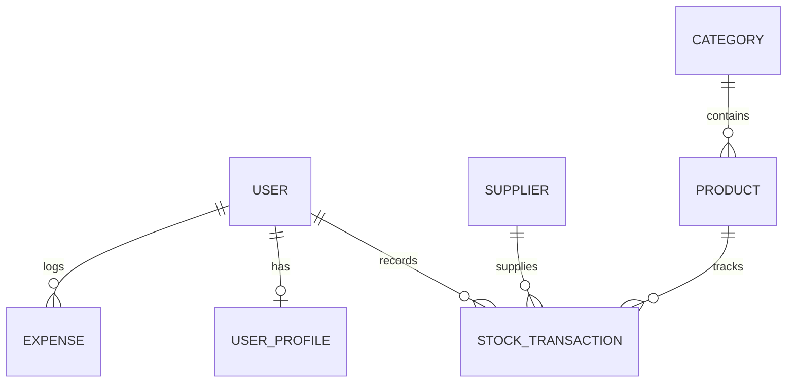

# Invenpro – Smart Inventory & Expense Management System

[](https://www.python.org/)
[](https://www.djangoproject.com/)
[](LICENSE)
[]()

> **Invenpro – Professional Inventory Management System for Restaurants, Cafés & Small Businesses**
> INT253 Coursework Project (Unit V: Django Models, Migrations, ORM &amp; Foreign Key Relationships)

---

## 1. Project Concept & Problem Statement

Small businesses, cafés, restaurants, and retail stores frequently rely on manual notebooks or disjointed spreadsheets to track ingredients, retail goods, and daily expenditures. This practice leads to:
* **Unexpected Stock Shortages:** Critical items running out during peak operating hours.
* **Capital Lockup & Spoilage:** Purchasing excess perishable stock without visibility into daily consumption rates.
* **Opaque Cash Flow:** Difficulty discerning purchase costs (direct cost of goods sold) from operational overheads (rent, utilities, wages).
* **Calculation Inaccuracies:** Human errors in updating quantities or computing monthly financial reports.

**Invenpro** provides a unified, centralized, real-time web application to control inventory movements, automate stock updates, track expenses, forecast stock exhaustion runway, and generate downloadable analytics reports.

### Brand & Features:
* **Brand Identity:** **Invenpro – Inventory Management System** with custom branding, logo, and sleek interface.
* **Indian Rupee (₹ INR) & Multi-Currency Localization:** All financial figures, reports, and purchase metrics formatted in **₹ INR** by default, with dynamic switching ($, €, £, د.إ).
* **Dark Mode & Light Mode:** Seamless theme toggling with persistent state.
* **Dedicated Settings Panel:** Manage business profile, GSTIN number, exchange rates, and UI preferences.
* **Direct Database CLI:** `python db_tool.py` for direct terminal database management.
* **Clean Starter Catalog:** Preloaded with essential categories and ingredients (Flour & Base).

---

## 2. System Architecture & Modular Design

StockWise is built on a clean, scalable Django multi-app modular architecture:

```
Pythonproject/ (StockWise)
│
├── manage.py
├── stockwise/             # Core project configuration
│   ├── settings.py
│   ├── urls.py
│   ├── wsgi.py
│   └── asgi.py
│
├── accounts/              # Module 6: User authentication, roles & staff permissions
│   ├── models.py          # UserProfile (Admin vs Staff role)
│   ├── forms.py
│   ├── views.py
│   ├── urls.py
│   └── decorators.py      # @admin_required permission control
│
├── inventory/             # Module 1 & 2: Products, Categories, Suppliers, Dashboard
│   ├── models.py          # Category, Supplier, Product
│   ├── forms.py
│   ├── views.py           # Dashboard, Catalog, Smart Alert calculations
│   ├── urls.py
│   ├── context_processors.py # Global stock alert badge counts
│   └── management/commands/seed_data.py # Automated realistic demo seeder
│
├── transactions/          # Module 3: Stock movements, audit history, atomic updates
│   ├── models.py          # StockTransaction (IN, OUT, ADJUSTMENT)
│   ├── forms.py
│   ├── views.py
│   └── urls.py
│
├── expenses/              # Module 4: Operating business expenses & categories
│   ├── models.py          # Expense (Rent, Utilities, Wages, Repairs, etc.)
│   ├── forms.py
│   ├── views.py
│   └── urls.py
│
├── reports/               # Module 5: Analytics, date-range filters, CSV exports
│   ├── forms.py
│   ├── views.py           # Product usage matrix, valuation, export handlers
│   └── urls.py
│
├── templates/             # Modern responsive UI templates
│   ├── base.html          # Sidebar, topbar, alert toasts, notifications
│   ├── accounts/
│   ├── dashboard/
│   ├── inventory/
│   ├── transactions/
│   ├── expenses/
│   └── reports/
│
├── static/                # Modern frontend assets
│   ├── css/stockwise.css  # Custom theme, stat cards, badges, responsive layout
│   └── js/stockwise.js   # Dynamic total calculator & client-side validation
│
└── db.sqlite3             # Relational SQLite database
```

---

## 3. The 6 Major Application Modules

### Module 1 – Operational Dashboard
* **KPI Metrics:** Total products in catalog, total inventory valuation, monthly stock-in purchases, monthly operating expenses.
* **Inventory Health Bar:** Real-time counts of Healthy, Low-Stock, and Out-of-Stock items.
* **Interactive Chart.js Visualizations:**
  * 7-day movement trend: Stock purchases ($) vs stock usage valuation ($).
  * Category valuation distribution doughnut chart.
* **Smart Alert Widget:** Highlights top items requiring urgent replenishment.
* **Recent Movement Feed:** Live feed of stock transactions with quick links.

### Module 2 – Product Management
* Complete catalog management with category grouping and measurement units (`kg`, `litre`, `pcs`, `box`, `pkt`, etc.).
* Threshold-based status indicators:
  * 🟢 **Healthy:** `current_stock > minimum_stock`
  * 🟡 **Low Stock:** `0 < current_stock <= minimum_stock`
  * 🔴 **Out of Stock:** `current_stock <= 0`
* Real-time search by product or category and multi-filter dropdowns.
* Dedicated **Product Detail View** featuring full transaction movement history, current financial valuation, and 7-day & 30-day burn rate metrics.

### Module 3 – Stock Movement Control (Transactions)
* **Stock-In (Purchases):** Records incoming stock, associates supplier, updates default purchase unit price, and computes total cost atomically:
  $$\text{New Stock} = \text{Current Stock} + \text{Purchased Quantity}$$
* **Stock-Out (Usage / Consumption):** Records consumption for kitchen prep or sales:
  $$\text{New Stock} = \text{Current Stock} - \text{Used Quantity}$$
  * *Strict Integrity Rule:* Validates inventory availability before deducting. Blocks transactions if requested quantity exceeds current stock.
* **Stock Adjustment (Audit):** Admin-restricted reconciliation of digital records with physical warehouse counts, generating an auditable discrepancy note.
* **Database Concurrency Safety:** Enforced via `django.db.transaction.atomic()` and `select_for_update()`.

### Module 4 – Expense Management
* Separation of concerns: Differentiates **Inventory Purchases** (captured directly from Stock-In transactions) from **Operational Overhead** (Rent, Utilities, Wages, Equipment Maintenance, Packaging Supplies).
* Prevents duplicate expense calculation while displaying a combined total monthly cash outflow.
* Search and category filter by expenditure type.

### Module 5 – Reports & Analytics
* Date-range filtering: Presets (*This Month, Last Month, Last 7 Days, Last 30 Days, This Year*) and Custom Date pickers.
* Visual bar chart of top consumed products by monetary value.
* Expense category breakdown doughnut chart.
* Comprehensive **Product-Wise Usage Matrix** detailing units purchased, total purchase spend, units consumed, consumption valuation, remaining stock, and asset value.
* One-click **CSV Data Exports**:
  * Stock-In Purchases CSV
  * Stock-Out Usage CSV
  * Operating Expenses CSV
  * Current Inventory Valuation CSV

### Module 6 – User & Role Management
* User registration, authentication, login/logout, and profile editing.
* **Role-Based Access Control (RBAC):**
  * **Admin:** Full control over products, categories, suppliers, physical adjustments, user management, and deletion actions.
  * **Staff:** Operational access to record daily stock-in, stock-out, add expenses, and view dashboard analytics.
* Dedicated staff management panel with instant role-toggle buttons.

---

## 4. Unique Feature: Smart Stock Alert & Consumption Analysis System

Instead of simply alerting when stock hits a fixed threshold, StockWise introduces an **Intelligent Consumption & Runway Forecasting Engine**:

1. **Windowed Consumption Analysis:** Calculates total units consumed in rolling 7-day and 30-day windows:
   $$\text{Daily Burn Rate} = \frac{\sum \text{Stock-Out Quantity in Window}}{\text{Window Days}}$$
2. **Predictive Depletion Runway:**
   $$\text{Remaining Runway (Days)} = \frac{\text{Current Available Stock}}{\text{Daily Burn Rate}}$$
3. **Automated Urgency Classification:**
   * 🔴 **Critical / Immediate:** Stock depleted ($\le 0$) or remaining runway $\le 2$ days.
   * 🟡 **Warning / Restock:** Below minimum threshold or remaining runway $\le 5$ days.
   * 🟢 **Healthy Buffer:** Runway $> 5$ days and current stock above minimum threshold.

### Current Active Fresh Inventory:
| Category | Product | Current Stock | Minimum Threshold | Status |
| :--- | :--- | :--- | :--- | :--- |
| **Flour** | **Maida** | `0.00 kg` | `50.00 kg` | 🔴 Out of Stock |
| **Flour** | **Atta** | `0.00 kg` | `10.00 kg` | 🔴 Out of Stock |
| **Base** | **Tea Powder** | `0.00 kg` | `1.00 kg` | 🔴 Out of Stock |
| **Base** | **Coffee Powder** | `0.00 kg` | `1.00 kg` | 🔴 Out of Stock |

---

## 5. Database Schema & Django ORM Relationships (Unit V Focus)



* **`accounts.UserProfile`**: One-to-One relationship with Django's built-in `User` model, extending it with `role` (`admin` / `staff`), `phone`, and `business_name`.
* **`inventory.Category`**: One-to-Many (`ForeignKey` with `on_delete=models.PROTECT`) with `Product` to prevent accidental orphaned catalog entries.
* **`inventory.Supplier`**: Stores vendor contact details; linked as optional `ForeignKey` with `on_delete=models.SET_NULL` on `StockTransaction` for purchase orders.
* **`inventory.Product`**: Core entity storing `purchase_price`, `current_stock`, and `minimum_stock`.
* **`transactions.StockTransaction`**: Central audit model recording movement type (`IN`, `OUT`, `ADJUSTMENT`), quantity, unit price, total amount, and operator.
* **`expenses.Expense`**: Captures operational non-inventory business overhead.

---

## 6. Quick Start & Setup Guide

### Prerequisites
* Python 3.10+ (Tested on Python 3.14)
* Django 5+ or 6+ (Installed: Django 6.1.2)

### Running the Project

1. **Navigate to the project root:**
   ```powershell
   cd "c:\LPU\7th sem\INT253\Pythonproject"
   ```

2. **Run migrations (already applied):**
   ```powershell
   python manage.py migrate
   ```

3. **Populate realistic demo data (already seeded):**
   ```powershell
   python manage.py seed_data
   ```

4. **Start the local development server:**
   ```powershell
   python manage.py runserver
   ```
   Open your browser at: `http://127.0.0.1:8000/`

---

## 7. Pre-Seeded Demonstration Accounts

| Role | Username | Password | Access Capabilities |
| :--- | :--- | :--- | :--- |
| **Administrator / Owner** | `admin` | `adminpassword123` | Full privileges: product deletion, stock adjustment, user management, Django admin. |
| **Staff / Kitchen Operator** | `staff_chef` | `staffpassword123` | Day-to-day operations: stock-in purchases, stock-out usage, view analytics. |

---

## 8. Running the Unit Test Suite

StockWise includes a comprehensive test suite testing atomic transactions, validation rules, burn rate predictions, and view endpoints:

```powershell
python manage.py test
```
*Result: 14 passing tests (`OK`).*

